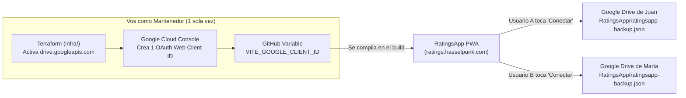

# Guía APB: Configuración de Google Drive Sync (Mantenedor vs. Usuario Final)

Esta guía explica paso a paso ("a prueba de balas") cómo funciona la sincronización con Google Drive en **RatingsApp**, por qué es **100% transparente para el usuario final**, qué gestiona **Terraform (`infra/`)** y qué único paso se realiza una vez en la consola de Google Cloud.

---

## 1. Concepto Clave (Cómo funciona sin que el usuario toque GCP)



- **Para el usuario final (Juan, María o vos mismo desde el celular)**:
  - **NO** crea proyectos en Google Cloud.
  - **NO** genera Client IDs ni toca opciones avanzadas.
  - Solo entra a `Ajustes` $\rightarrow$ toca **Conectar con Google Drive** $\rightarrow$ elige **su propia cuenta de Google** y acepta el permiso limitado (`drive.file`).
  - Los datos se guardan **directamente desde su navegador hacia su propio Google Drive**. Tu proyecto de GCP nunca recibe ni almacena los datos de nadie: solo sirve para que Google sepa *"esta pantalla de login pertenece a RatingsApp"*.

- **¿Por qué hoy te pedía un Client ID al probar en local?**
  - Porque el build actual todavía no tiene cargada la variable `VITE_GOOGLE_CLIENT_ID`. Una vez que la configurás en GitHub Actions (y en `.env.local` para desarrollo), el usuario final nunca ve ese campo: solo ve el botón **Conectar con Google Drive**.

---

## 2. Paso 1: Aprovisionar el Proyecto GCP con Terraform (`infra/`)

> Requisitos en tu máquina local: [Google Cloud CLI (`gcloud`)](https://cloud.google.com/sdk/docs/install) y [Terraform](https://developer.hashicorp.com/terraform/install) `>= 1.10.0`.

1. Autenticate con Google Cloud sin descargar claves JSON:
   ```bash
   gcloud auth login
   ```
2. Creá el proyecto en GCP (si el ID `ratingsapp-sync` ya estuviera tomado globalmente, usá otro como `ratingsapp-hassel`):
   ```bash
   gcloud projects create ratingsapp-sync --name="RatingsApp"
   gcloud config set project ratingsapp-sync
   gcloud auth application-default login
   gcloud auth application-default set-quota-project ratingsapp-sync
   ```
3. Configurá tus variables locales de Terraform:
   ```bash
   cd infra
   cp terraform.tfvars.example terraform.tfvars
   ```
   *(Editá `infra/terraform.tfvars` si elegiste otro `project_id`. Este archivo está en `.gitignore` y nunca se sube a Git).*
4. Creá el bucket para el estado remoto de Terraform en GCS (Free Tier 5 GB en `us-central1`) y ejecutá Terraform para activar `drive.googleapis.com` *(nota: `infra/versions.tf` ya viene configurado con `backend "gcs"`; si querés solo validar sintaxis sin bucket usá `terraform init -backend=false`)*:
   ```bash
   gcloud storage buckets create gs://ratingsapp-sync-tfstate --location=us-central1 --uniform-bucket-level-access
   gcloud storage buckets update gs://ratingsapp-sync-tfstate --versioning
   terraform init
   terraform fmt -check
   terraform validate
   terraform plan
   terraform apply
   ```
   Al finalizar, Terraform muestra `oauth_console_url` con el enlace directo a tu proyecto.

---

## 3. Paso 2: Crear el OAuth Web Client ID en Google Cloud Console (1 sola vez)

> **¿Por qué este paso no está en `infra/main.tf`?** Porque Google Cloud no expone ningún recurso oficial en Terraform (ni en `gcloud`) para crear clientes OAuth web externos con *Authorized JavaScript origins* ni configurar la pantalla de consentimiento externa (`drive.file`).

1. Abrí la URL que imprimió Terraform (`https://console.cloud.google.com/auth/overview?project=<tu-project-id>`).
2. **Branding / OAuth Consent Screen**:
   - **App name**: `RatingsApp`
   - **User support email**: tu email.
   - **Application home page**: `https://ratings.hasselpunk.com`
   - **Application privacy policy link**: `https://ratings.hasselpunk.com/privacy.html` *(servida estáticamente desde `public/privacy.html`)*
   - **Authorized domains**: `hasselpunk.com`
   - **Audience (User Type)**: **External** (para que cualquier cuenta `@gmail.com` pueda usar la app en producción).
   - **Developer contact information**: tu email.
3. **Data Access (Scopes)**:
   - Clic en **Add or remove scopes** $\rightarrow$ buscá y marcá exactamente:
     `https://www.googleapis.com/auth/drive.file`
     *(Ver, editar, crear y eliminar **solo** los archivos específicos de Google Drive que cree esta app).*
4. **Clients $\rightarrow$ Create Client**:
   - **Application type**: `Web application`
   - **Name**: `RatingsApp Web`
   - **Authorized JavaScript origins** (agregar ambos):
     - `https://ratings.hasselpunk.com` *(producción)*
     - `http://localhost:5173` *(desarrollo local)*
   - *(Dejar **Authorized redirect URIs** vacío; el flujo GIS Token Model trabaja directo en el navegador).*
5. Copiá el **Client ID** generado (formato `1234567890-abcdefg.apps.googleusercontent.com`).
   - *Nota*: Este `Client ID` es **público** (no tiene Client Secret ni credenciales privadas). La protección es que Google solo acepta tokens desde los orígenes autorizados en el punto 4.

### Importante sobre "Testing" vs "Production" en Audience
- **Mientras la app esté en estado `Testing`**: solo podrán conectarse las cuentas Gmail que agregues manualmente en **Audience $\rightarrow$ Test users** (agregá tu propio email para probar).
- **Cuando quieras abrirla a cualquier usuario final**: en **Audience**, hacé clic en **Publish App** (estado `In production`). Con el scope `drive.file`, cualquier usuario podrá elegir su propia cuenta de Google Drive sin que tengas que agregarlo a mano.

---

## 4. Paso 3: Conectar el Client ID en GitHub y en Local

### A. Para Producción (`https://ratings.hasselpunk.com` — transparente para usuarios)
1. En tu repositorio de GitHub (`augustohassel/RatingsApp`), andá a:
   **Settings $\rightarrow$ Secrets and variables $\rightarrow$ Actions $\rightarrow$ pestaña `Variables`**.
2. Creá una nueva variable de repositorio:
   - **Name**: `VITE_GOOGLE_CLIENT_ID`
   - **Value**: el Client ID (`...apps.googleusercontent.com`) copiado en el Paso 2.
3. El workflow [`.github/workflows/deploy.yml`](../.github/workflows/deploy.yml) inyecta automáticamente `VITE_GOOGLE_CLIENT_ID: ${{ vars.VITE_GOOGLE_CLIENT_ID }}` al compilar.

### B. Para Desarrollo Local (`http://localhost:5173`)
Elegí una de estas dos opciones:
- **Opción 1 (archivo `.env.local`)**:
  ```bash
  cp .env.example .env.local
  ```
  Pegá tu Client ID en `VITE_GOOGLE_CLIENT_ID=...` dentro de `.env.local` (ignorado por Git) y reiniciá `npm run dev`.
- **Opción 2 (directo en la UI)**:
  Abrí `http://localhost:5173` $\rightarrow$ **Ajustes** $\rightarrow$ pegá el Client ID en **Google OAuth Client ID (Opcional / Avanzado)** $\rightarrow$ **Aplicar**.

---

## 5. Verificación Final (Qué observa el usuario)
1. Abrí **Ajustes $\rightarrow$ Sincronización Personal (Google Drive)**.
2. El botón principal dice **Conectar con Google Drive** (sin pedir ningún Client ID).
3. Al pulsarlo, se abre el selector estándar de Google donde cada usuario elige **su cuenta**, acepta el permiso sobre archivos de RatingsApp y aparece `RatingsApp/ratingsapp-backup.json` en su Google Drive.

---

## 6. Estado Remoto en GCS y CI/CD con OIDC (Estilo `MiBarcito`)

Para que GitHub Actions ejecute automáticamente `terraform plan` en cada PR y `terraform apply` al mergear en `master` sin guardar claves JSON (el estado remoto ya apunta a `gs://ratingsapp-sync-tfstate` en [`infra/versions.tf`](../infra/versions.tf)):

1. Activá `enable_github_oidc = true` en `infra/terraform.tfvars` y corré `terraform apply` dentro de `infra/`.
2. Cargá en GitHub (**Settings $\rightarrow$ Secrets and variables $\rightarrow$ Actions $\rightarrow$ Variables**):
   - `GCP_PROJECT_ID`: tu `project_id` (ej. `ratingsapp-sync`)
   - `GCP_WORKLOAD_IDENTITY_PROVIDER`: valor del output `workload_identity_provider` de Terraform
   - `GCP_SERVICE_ACCOUNT`: valor del output `github_actions_service_account` de Terraform
   Con esas 3 variables definidas, [`.github/workflows/terraform-validate.yml`](../.github/workflows/terraform-validate.yml) habilita automáticamente los jobs `plan` y `apply`.

---

## 7. Mapa Rápido de Verificación en Google Cloud Console

Reemplazá `<PROJECT_ID>` por el ID de tu proyecto (ej. `ratingsapp-sync`):

| Qué querés revisar | Enlace directo |
| :--- | :--- |
| **APIs habilitadas (`drive.googleapis.com`)** | `https://console.cloud.google.com/apis/dashboard?project=<PROJECT_ID>` |
| **Pantalla de consentimiento y OAuth Client ID** | `https://console.cloud.google.com/auth/overview?project=<PROJECT_ID>` |
| **Bucket `tfstate` en Cloud Storage** | `https://console.cloud.google.com/storage/browser?project=<PROJECT_ID>` |
| **Pool OIDC y Service Account de CI/CD** | `https://console.cloud.google.com/iam-admin/workload-identity-pools?project=<PROJECT_ID>` |
| **Facturación y alertas ($0.00 USD/mes)** | `https://console.cloud.google.com/billing?project=<PROJECT_ID>` |


